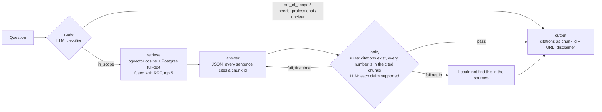

# newcomer-docs-agent

- **What it does:** answers Ontario newcomer questions (SIN, OHIP, bank account, first tax return, driver's licence) only from 20 official government pages, with an inline citation on every sentence, and refuses when the pages don't cover it or the question needs personal legal, tax or immigration advice.
- **Stack:** Python 3.11, LangGraph, FastAPI, Pydantic, PostgreSQL + pgvector, local `BAAI/bge-small-en-v1.5` embeddings, DeepSeek (`deepseek-flash`) through its OpenAI-compatible API, pytest, Docker Compose, GitHub Actions.
- **Held-out result (frozen test set, second and last `--final` run):** all key facts present in 86.4% of answerable questions (95% bootstrap CI 72.7–100%, n=22), up from 77.3% in the first run; refusal accuracy 96.7% (CI 90.0–100%, n=30), up from 90.0%; every answered, answerable question cited an expected source (n=21). This test set had already been seen once, so the second run is not a clean held-out estimate (see [below](#held-out-test-set-30-questions-frozen-by-sha256)).
- **Run:** `uv sync --extra embed --extra dev` → `python -m src.ingest` → `python -m src.graph "How do I apply for a SIN?"` or `docker compose up` (see [Run it](#run-it)); evaluate with `python -m src.evaluate --split dev`.
- **Chat page:** open <http://localhost:8000/> once the API is running: a retro, frosted-glass page that shows cited answers, refusals with their route, and API health (see [Use the chat page](#use-the-chat-page)).
- **Local-only:** page text, embedding and LLM caches, full answers and the spend ledger live in the gitignored `data/local/`; CI runs on paraphrased fixture pages with cached responses.

## The problem

Someone new to Ontario has the same five errands in their first weeks: get a SIN, apply for OHIP, open a bank account, file a first tax return, and exchange a driver's licence. The answers are on Canada.ca and ontario.ca, but spread over dozens of pages, and a general chatbot will happily invent a waiting period or a form number. I wanted an assistant that only says what the official pages say, shows where each sentence came from, and says "I could not find this in the sources" or "please talk to a professional" instead of guessing.

## How it works



- **Ingest** (`src/ingest.py`): fetches the 20 pages listed in [`data/SOURCES.md`](data/SOURCES.md), strips navigation, splits on headings first and then into chunks of at most ~500 tokens with 80 tokens of overlap, embeds them with bge-small (batches of 16) and stores them in pgvector. Each chunk keeps its heading path, URL and fetch date.
- **Graph** (`src/graph.py`): a LangGraph `StateGraph` with the five nodes above. Route labels are `in_scope`, `out_of_scope`, `needs_professional` and `unclear`.
- **LLM** (`src/llm.py`): one interface with a `live` provider (DeepSeek) and a `cached` replay provider. Every response is stored on disk under a sha256 of the model, messages and parameters; a spend ledger estimates cost from the token usage and refuses new live calls past $1.50.
- **API** (`src/api.py`): `POST /ask` and `GET /health`.

## Results

### Held-out test set (30 questions, frozen by sha256)

I have scored the test set twice with `--final`: once for the first version, and once for the second round of changes (routing and answer prompts, repeated-sentence removal). The sha256 of `data/questions/test.jsonl` was unchanged before the second run.

| metric | first run | 95% CI | second run | 95% CI | change (paired) | 95% CI of change | n |
|---|---|---|---|---|---|---|---|
| all key facts present (`facts_all`) | 0.7727 | 0.5909–0.9091 | 0.8636 | 0.7273–1.0 | +0.0909 | 0.0–0.2273 | 22 answerable |
| key-fact recall | 0.8182 | 0.6591–0.9545 | 0.9091 | 0.7955–1.0 | +0.0909 | 0.0–0.2273 | 22 |
| retrieval recall@5 (expected URL retrieved) | 0.9545 | 0.8636–1.0 | 0.9545 | 0.8636–1.0 | 0.0 | 0.0–0.0 | 22 |
| retrieval MRR | 0.9015 | 0.7877–1.0 | 0.9015 | 0.7877–1.0 | 0.0 | 0.0–0.0 | 22 |
| answer cites an expected URL | 1.0 | 1.0–1.0 | 1.0 | 1.0–1.0 | 0.0 | 0.0–0.0 | 19 → 21 answered |
| every cited sentence passes the support check | 1.0 | 1.0–1.0 | 1.0 | 1.0–1.0 | 0.0 | 0.0–0.0 | 19 → 21 |
| route accuracy | 0.9 | 0.7667–1.0 | 0.9667 | 0.9–1.0 | +0.0667 | 0.0–0.1667 | 30 |
| refusal accuracy (refused exactly when it should) | 0.9 | 0.7667–1.0 | 0.9667 | 0.9–1.0 | +0.0667 | 0.0–0.1667 | 30 |

Both runs: 500-token chunks, top 5, hybrid retrieval, verification on, no reranker. CIs are percentile bootstrap, 10,000 resamples, seed 42; the change CI resamples question ids and pairs the two runs (`python -m src.evaluate --compare A B`, saved in [`eval_runs/test-c500-k5-hybrid-verify-v6/compare_vs_previous.txt`](eval_runs/test-c500-k5-hybrid-verify-v6/compare_vs_previous.txt)). Cost of the second run: about $0.0209 (estimate).

How to read this:

- **The gain is two questions, test-02 and test-22**, both previously refused by an over-cautious router. Nothing got worse on any metric, question by question. Every change CI has 0.0 as its lower bound, so this does not show a reliable improvement on its own.
- **It is not a clean held-out number.** The router changes went after the over-cautious routing that my first test run exposed and [`docs/failure_analysis.md`](docs/failure_analysis.md) documented. I tuned the prompts on dev only and looked at no new test failures, but the direction came partly from this test set, so the second-run figures are likely optimistic. A fresh held-out set would be needed for an honest estimate.
- **The first run's caveats still hold:** test-21 (a retrieval miss caused by hybrid fusion), test-01 (chunk-level retrieval miss), test-16 (scorer strictness) and test-30 (right refusal, wrong route label) fail in both runs.

### Dev experiments (40 questions; retrieval and fact metrics on the 28 answerable ones)

| run | recall@k | MRR | fact recall | all facts (95% CI) | citation support | refusal acc. | live LLM calls | est. cost |
|---|---|---|---|---|---|---|---|---|
| 500 tokens, k=5, vector, verify (baseline) | 0.964 | 0.946 | 0.926 | 0.857 (0.714–0.964) | 1.000 | 0.975 | 81 | $0.0191 |
| 300 tokens | 0.964 | 0.946 | 0.923 | 0.857 | 1.000 | 0.975 | 57 | $0.0185 |
| 800 tokens | 0.964 | 0.946 | 0.934 | 0.893 | 0.963 | 0.975 | 57 | $0.0200 |
| k=3 | 0.929 | 0.946 | 0.878 | 0.786 | 1.000 | 0.950 | 46 | $0.0082 |
| k=8 | 0.982 | 0.946 | 0.934 | 0.893 | 0.963 | 0.975 | 44 | $0.0131 |
| **hybrid (vector + full-text, RRF) — chosen** | 0.982 | 0.929 | 0.946 | **0.929 (0.821–1.000)** | 1.000 | 0.975 | 47 | $0.0197 |
| no verify node | 0.964 | 0.946 | 0.934 | 0.893 | 1.000 | 0.975 | 0 (all cached) | $0 |

Route accuracy was 0.975 (n=40) and expected-URL citation 1.000 (n=26–27) in every run. Every difference above is one to three questions out of 28, inside the CIs. I picked hybrid by a rule written down before comparing (highest all-facts, then refusal accuracy, then cost), not because it is clearly better. Raw outputs: [`eval_runs/`](eval_runs/).

### Second round on dev: prompts, repeated sentences and a reranker

All on dev only. "v2"–"v5" are successive prompt versions (routing calibration and an anti-repetition rule in the answer prompt); "v6" is v5 plus a deterministic step that drops a sentence whose words and numbers all appear in one earlier sentence (moving its citations onto that sentence). `bge-rerank` means `BAAI/bge-reranker-base` reorders the pooled candidates.

| run | route acc. | recall@k | MRR | fact recall | all facts (95% CI) | refusal acc. | live LLM calls | est. cost |
|---|---|---|---|---|---|---|---|---|
| first-round choice (hybrid, prompts v1) | 0.975 | 0.9821 | 0.9286 | 0.9464 | 0.9286 (0.8214–1.0) | 0.975 | 47 | — |
| hybrid, prompts v2 | 0.925 | 0.9821 | 0.9286 | 0.9167 | 0.8929 (0.7857–1.0) | 0.95 | 90 | $0.0271 |
| bge-rerank (vector pool), v2 | 0.925 | 1.0 | 0.9643 | 0.8988 | 0.8571 (0.7143–0.9643) | 0.95 | 46 | $0.0203 |
| bge-rerank (hybrid pool), v2 | 0.925 | 0.9821 | 0.9643 | 0.8988 | 0.8571 (0.7143–0.9643) | 0.95 | 8 | $0.0031 |
| hybrid, v3 | 0.925 | 0.9821 | 0.9286 | 0.9881 | 0.9643 (0.8929–1.0) | 1.0 | 37 | $0.0055 |
| bge-rerank (vector pool), v3 | 0.925 | 1.0 | 0.9643 | 0.9702 | 0.9286 (0.8214–1.0) | 1.0 | 3 | $0.0013 |
| hybrid, v4 | 1.0 | 0.9821 | 0.9286 | 0.9881 | 0.9643 (0.8929–1.0) | 1.0 | 40 | $0.0032 |
| bge-rerank (vector pool), v4 | 1.0 | 1.0 | 0.9643 | 0.9702 | 0.9286 (0.8214–1.0) | 1.0 | 0 | $0 |
| bge-rerank (hybrid pool), v4 | 1.0 | 0.9821 | 0.9643 | 0.9702 | 0.9286 (0.8214–1.0) | 1.0 | 0 | $0 |
| hybrid, v5 | 1.0 | 0.9821 | 0.9286 | 1.0 | 1.0 (1.0–1.0) | 1.0 | 51 | $0.0257 |
| **hybrid, v6 — chosen** | 1.0 | 0.9821 | 0.9286 | 1.0 | **1.0 (1.0–1.0)** | 1.0 | 0 (all cached) | $0 |
| bge-rerank (vector pool), v6 | 1.0 | 1.0 | 0.9643 | 0.9881 | 0.9643 (0.8929–1.0) | 1.0 | 46 | $0.0211 |
| bge-rerank (hybrid pool), v6 | 1.0 | 0.9821 | 0.9643 | 0.9702 | 0.9286 (0.8214–1.0) | 1.0 | 9 | $0.0036 |

Citation URL hit and citation support were 1.0 in every run. Against the first-round choice, the chosen v6 config gained dev-14 (now routed in scope) and dev-28 (now names form RC151); paired change in all-facts +0.0714 (95% CI 0.0–0.1786, n=28). The v4 routing sentences (about bank-account comparisons and about personal advice outside the covered topics) and the v5 rule to name forms exactly were written for specific dev misses (dev-39, dev-34, dev-37 and dev-28). I applied the same selection rule as before, and it picked v6 **without** the reranker. A dev score of 1.0 after four prompt revisions on the same 40 questions is overfitted to dev, which is part of why the test number above matters.

**Reranker.** I compared three small open cross-encoders on dev retrieval only (no LLM calls), reranking the vector top 20 or the union of vector and full-text top 20 ([`eval_runs/retrieval-dev-rerank/results.txt`](eval_runs/retrieval-dev-rerank/results.txt)):

| reranker (params) | pool | recall@1 | recall@3 | recall@5 | MRR (top 5) |
|---|---|---|---|---|---|
| none (vector only) | — | 0.750 | 0.929 | 0.964 | 0.946 |
| none (hybrid RRF, chosen) | — | 0.714 | 0.911 | 0.982 | 0.929 |
| cross-encoder/ms-marco-MiniLM-L-6-v2 (22M) | vector / hybrid | 0.732 | 0.946 | 1.000 | 0.946 |
| mixedbread-ai/mxbai-rerank-xsmall-v1 (~70M) | vector / hybrid | 0.714 | 0.964 | 0.982 | 0.923 |
| BAAI/bge-reranker-base (278M) | vector | 0.768 | 0.964 | 1.000 | 0.964 |
| BAAI/bge-reranker-base (278M) | hybrid | 0.768 | 0.964 | 0.982 | 0.964 |

`bge-reranker-base` was the best reranker on every dev retrieval number. The 28 questions took about 54 s on 8 CPU cores, including loading the model, so the latency is acceptable for a chat page. It was the one I took into full runs. End to end it lost by one question on all-facts (0.9643 vs 1.0), so the rule left it out. It stays in the code behind `RAG_RERANK=<model>` (scores cached in sqlite like the embeddings), off by default, and is not in the Docker image. I did not try larger rerankers such as `bge-reranker-v2-m3` (568M), so whether they would do better here is not yet verified by me.

**Repeated sentences.** The chat page's licence example used to state the 60-day rule in four sentences. With the v5 prompt and the v6 dedupe step it states it in two (how long you can drive, then that you must switch after that). I also added a `repeat_free` diagnostic (a sentence with at least 80% of its content words in one earlier sentence counts as a repeat). Recomputed from the saved answers it was 26/27 → 27/28 on dev and 16/19 → 18/21 on test. It is a lexical heuristic that misses repeats in different words, so I don't gate on it.

## Run it

Needs Python 3.11, [uv](https://docs.astral.sh/uv/), Docker, and a DeepSeek API key in `.env` (copy `.env.example`).

```bash
uv sync --extra embed --extra dev
docker run -d --name ndocs-pg -e POSTGRES_USER=rag -e POSTGRES_PASSWORD=rag -e POSTGRES_DB=rag \
  -p 5433:5432 pgvector/pgvector:pg16
uv run python -m src.ingest --sizes 500          # fetch the 20 pages into data/local/, chunk, embed
uv run python -m src.graph "Is there a waiting period for OHIP?"
uv run python -m src.evaluate --split dev        # metrics with CIs into eval_runs/
uv run pytest -q && uv run ruff check .
```

Docker: `docker compose up --build` starts Postgres and the API on <http://localhost:8000>:

```bash
curl -s localhost:8000/health
curl -s -X POST localhost:8000/ask -H 'Content-Type: application/json' \
  -d '{"question": "How long can I drive in Ontario on a licence from another country?"}'
```

### Use the chat page

With the API running (`uv run uvicorn src.api:app` locally, or Docker as below), open <http://localhost:8000/>. Type a question and press Enter, or tap one of the example chips. Citation numbers link to the official page each sentence came from, and the sources list under the answer shows the page, section and fetch date. Refusals (out of scope, needs a professional, unclear, could not find it) show in an amber panel with their route label. The top strip shows `/health`. The page is plain HTML, CSS and JavaScript in `src/static/`, served by FastAPI, with no build step and nothing loaded from other sites.


White text on the orange buttons and on my own message bubbles measures at least 4.5:1 (WCAG AA for normal text). [`scripts/check_contrast.py`](scripts/check_contrast.py) renders the page in headless Chrome and compares white with the lightest pixel behind the text: the Ask button is 5.10:1 at 1280 px wide and 4.96:1 at 390 px (it was 1.60:1 and 1.56:1), and the user bubble is 5.73:1 (was 2.67:1).

On my machine the default bridge network was broken, so I ran it with the host-network override: `docker compose -f docker-compose.yml -f docker-compose.hostnet.yml up` (details in [`docs/docker_evidence.md`](docs/docker_evidence.md)).

The test split is frozen: `python -m src.evaluate --split test` refuses to run without `--final`, and checks the file against `data/questions/test.sha256`.

## Known limitations

- **CI runs on cached responses, which proves less than it looks.** GitHub Actions lints, runs 30 unit tests, ingests 16 short fixture pages I wrote (paraphrases, not the official text), and replays the dev evaluation with cached embeddings and cached DeepSeek responses, failing below [`ci/thresholds.json`](ci/thresholds.json). That proves the whole pipeline runs and is deterministic, and that a change to retrieval, chunking or prompts is noticed: in [the degrade PR](https://github.com/AbhishekRamma/newcomer-docs-agent/pull/2) (top 5 → top 1) the gate went red. For the second round I rebuilt the caches with [`scripts/build_ci_cache.sh`](scripts/build_ci_cache.sh) and checked locally, with the CI settings, that the replay passes and that top-k 1 still fails the gate. It does **not** grade new model output: a changed prompt misses the cache and the agent refuses, so the gate goes red whether or not the change was good. Answer quality on the real pages comes only from local runs.
- **The questions were drafted by the agent from the sources.** All 70 questions, their expected routes, expected URLs and key facts were drafted by the agent from the sources, and every key fact was checked mechanically against the fetched pages. My own review of them is pending, so treat the question set as **not verified**.
- **Rule-based scoring.** Key facts are matched as normalised strings (with alternatives), so a correct paraphrase can score as a miss (test-16 is one). Citation support is a lexical heuristic (≥60% of content words and every number present in the cited chunk), not an entailment model.
- **The verify node caught nothing real on dev.** It triggered one retry in the baseline run, which was a false positive. I kept it because it is part of the design and it is cheap insurance, but on these 40 questions it did not earn its cost.
- **Small samples.** n=22 answerable test questions gives CIs about ±16 points wide.
- **The test set has been used twice.** Its second run scored changes aimed at failures the first run exposed, so it is no longer an independent held-out set.
- **Plain `docker compose up` did not work on my build box** (no container-to-container traffic or DNS on the bridge network); the host-network override did. Plain compose on another machine is not verified. The container also expects the pages already fetched into `data/local/`; a cold start fetches them with httpx, and Canada.ca sometimes blocks that (locally I fall back to headless Chrome, which the image doesn't include).
- **Pages change.** Answers are only as current as the fetch date shown on every citation (2026-10-24).
- **Spend figures are estimates** from token counts and DeepSeek's published prices, not a bill.

## Data and licence notes

- No government page text is committed. The repo holds the URL list, my code, the questions, metric files without answer text, and CI fixtures I wrote myself (CC0). A pre-push script ([`scripts/prepush_scan.py`](scripts/prepush_scan.py)) checks every tracked file and the full `git log -p` for API keys and for any 12-word run copied from the fetched pages.
- Canada.ca pages: reusable for non-commercial purposes with attribution and a link ([terms](https://www.canada.ca/en/transparency/terms.html)). ontario.ca pages: © King's Printer for Ontario; non-commercial reproduction allowed with credit and without changes ([copyright](https://www.ontario.ca/page/copyright-information)). Page-specific notices and Open Government Licence – Ontario labels were not checked page by page: **unverified**. See [`data/SOURCES.md`](data/SOURCES.md).
- This is general information, not legal, tax or immigration advice, and it is not affiliated with any government.
- Decisions, spend and what I'd change next: [`docs/journal.md`](docs/journal.md).
