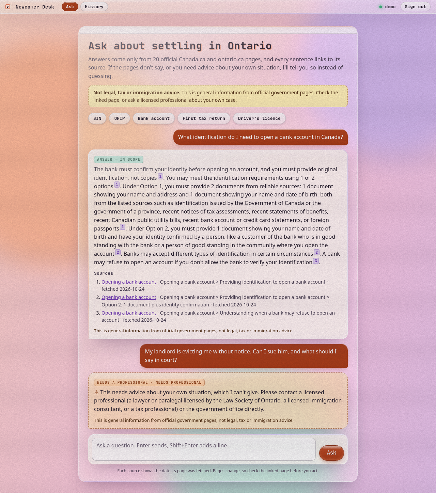
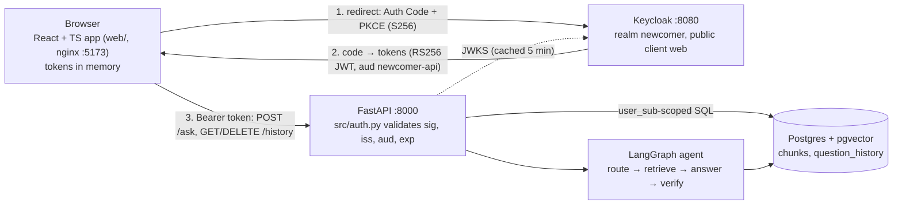
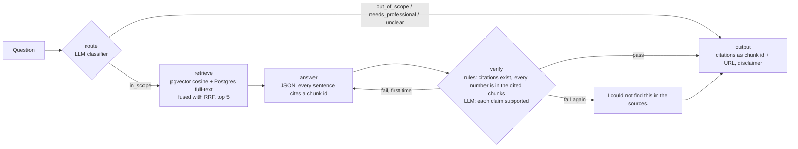

# newcomer-docs-agent

**Answers Ontario newcomer questions (SIN, OHIP, bank account, first tax return, driver's licence) only from 20 official government pages, with a citation on every sentence, and refuses when the pages don't cover it or the question needs personal legal, tax or immigration advice. You sign in with OIDC, and each user gets their own saved question history.**



## Why

Newcomers to Ontario face the same five errands. The answers are spread over dozens of Canada.ca and ontario.ca pages, and a general chatbot will happily invent a waiting period or a form number. I wanted an assistant that only says what the official pages say, shows where each sentence came from, and says "I could not find this in the sources" or "please talk to a professional" instead of guessing.

## Architecture





- **Stack:** React 18 + TypeScript (strict) + Vite with `oidc-client-ts` against Keycloak; FastAPI validating RS256 JWTs with PyJWT; PostgreSQL + pgvector; Python 3.11, LangGraph, local `bge-small` embeddings, DeepSeek (`deepseek-flash`); pytest, Vitest, ESLint, Docker Compose, GitHub Actions.
- **Ingest** (`src/ingest.py`): fetches the pages in [`data/SOURCES.md`](data/SOURCES.md), chunks on headings (at most ~500 tokens) and stores the vectors with heading path, URL and fetch date.
- **LLM layer** (`src/llm.py`): a `live` DeepSeek provider and a `cached` replay provider. Every response is stored under a sha256 of the model, messages and parameters, and a spend ledger refuses new live calls past $1.50.
- **API:** `POST /ask`, `GET /history` and `DELETE /history/{id}`, all scoped to the token's `sub`; another user's row returns 404. Token checks are described in [`docs/auth_design.md`](docs/auth_design.md).

## Held-out results

30 questions frozen by sha256 (22 answerable). I scored the test set twice with `--final`: once for the first version and once after a second round of prompt changes. CIs are percentile bootstrap, 10,000 resamples, seed 42; the change CI pairs the two runs by question.

| metric | first run | second run | change (95% CI) | n |
|---|---|---|---|---|
| all key facts present | 0.773 (0.591–0.909) | **0.864** (0.727–1.0) | +0.091 (0.0–0.227) | 22 |
| key-fact recall | 0.818 | 0.909 | +0.091 (0.0–0.227) | 22 |
| retrieval recall@5 | 0.955 | 0.955 | 0.0 | 22 |
| retrieval MRR | 0.9015 | 0.9015 | 0.0 | 22 |
| answer cites an expected URL | 1.0 | 1.0 | 0.0 | 19 → 21 answered |
| every cited sentence passes the support check | 1.0 | 1.0 | 0.0 | 19 → 21 |
| route accuracy | 0.9 | 0.967 | +0.067 (0.0–0.167) | 30 |
| refusal accuracy | 0.9 (0.767–1.0) | **0.967** (0.9–1.0) | +0.067 (0.0–0.167) | 30 |

Second-run cost: about $0.0209 (estimate). Saved comparison: [`eval_runs/test-c500-k5-hybrid-verify-v6/compare_vs_previous.txt`](eval_runs/test-c500-k5-hybrid-verify-v6/compare_vs_previous.txt).

How to read this:
- **0.864 is not a clean held-out number.** The second round fixed the over-cautious routing that my first test run exposed. I tuned on dev only and read no new test failures, but the direction came partly from this test set, so the second-run figures are likely optimistic.
- **The gain is two questions** (test-02 and test-22). Nothing got worse, but every change CI has 0.0 as its lower bound.
- **Known misses remain:** test-21 (a retrieval miss caused by hybrid fusion), test-01 (chunk-level miss), test-16 (scorer strictness) and test-30 (right refusal, wrong route label). See [`docs/failure_analysis.md`](docs/failure_analysis.md).

Every dev configuration I compared (chunk size, top-k, hybrid retrieval, prompt versions, three rerankers) is in [`docs/dev_experiments.md`](docs/dev_experiments.md).

## How to run

Needs Docker with Compose v2. The page text and caches must already be in `data/local/` (from the ingest step below); with `LLM_PROVIDER=cached` the API answers only from cached responses and needs no API key.

```bash
# Full stack. My build machine's bridge network doesn't work, so I use the host-network override:
LLM_PROVIDER=cached sudo -E docker compose -f docker-compose.yml -f docker-compose.hostnet.yml up -d --build
```

Open <http://localhost:5173>, press **Sign in** and use `demo` / `demo-only-not-a-secret` (local demo credentials in [`keycloak/realm-newcomer.json`](keycloak/realm-newcomer.json)). A second user, `demo2`, shows that history is isolated.

Backend and evaluation (Python 3.11, [uv](https://docs.astral.sh/uv/), and a DeepSeek key in `.env` for live answers):

```bash
uv sync --extra embed --extra dev
docker run -d --name ndocs-pg -e POSTGRES_USER=rag -e POSTGRES_PASSWORD=rag -e POSTGRES_DB=rag \
  -p 5433:5432 pgvector/pgvector:pg16
uv run python -m src.ingest --sizes 500          # fetch the 20 pages into data/local/, chunk, embed
uv run python -m src.migrate                     # create question_history (idempotent)
uv run python -m src.evaluate --split dev        # metrics with CIs into eval_runs/
uv run pytest -q && uv run ruff check .
```

Web app on its own: `cd web && cp .env.example .env.local && npm ci && npm run dev`. The test split refuses to run without `--final` and is checked against `data/questions/test.sha256`. `AUTH_DISABLED=1` runs every request as `local-dev` for local evaluation and CI only; it is off by default.

## How it's tested

- **62 pytest tests** (including the history store against a real Postgres service, with `REQUIRE_PG=1` so it can't skip quietly) and **17 Vitest tests**; ESLint with `strictTypeChecked` and `tsc --noEmit` on strict TypeScript.
- **A cached-replay evaluation gate.** CI ingests 16 short fixture pages I wrote (paraphrases, CC0), replays the dev evaluation with cached embeddings and cached DeepSeek responses, and fails below [`ci/thresholds.json`](ci/thresholds.json). That proves the pipeline runs end to end and is deterministic, at no API cost. It does not grade new model output: a changed prompt misses the cache and the gate goes red whether or not the change was good. Details in [`ci/README.md`](ci/README.md).
- **Gates I broke on purpose.** [PR #2](https://github.com/AbhishekRamma/newcomer-docs-agent/pull/2) and [PR #6](https://github.com/AbhishekRamma/newcomer-docs-agent/pull/6) cut retrieval to top 1, and [PR #8](https://github.com/AbhishekRamma/newcomer-docs-agent/pull/8) skipped the token audience check. CI went red on all three, and all three were closed unmerged.
- **Integration checks against the real stack:** a scripted PKCE sign-in with 401/200, history isolation and CORS checks, plus a headless-Chromium run of sign-in, silent re-sign-in on reload and sign-out ([`docs/auth_evidence.md`](docs/auth_evidence.md), [`docs/docker_evidence.md`](docs/docker_evidence.md)).

## How I built this

I designed and built this project using AI coding agents as my engineering team. I owned the architecture, the evaluation design and the acceptance criteria. The agents wrote most of the code to my specs; I reviewed what they produced and accepted a change only when it passed tests and gates I had set in advance. The evidence is in the repo:

- **A frozen test set.** 30 questions split off before any tuning, frozen with a sha256 and refused by the evaluator without `--final`. I report both runs on it, and say plainly that the second is no longer clean.
- **Pre-registered selection rules.** Before comparing configurations I wrote down how I'd pick: highest all-facts, then refusal accuracy, then cost. That rule left out a reranker that won on retrieval but lost by one question end to end.
- **Statistics on every number.** Bootstrap CIs everywhere, and a paired CI on every change, so a two-question gain isn't sold as an improvement.
- **Gates I broke on purpose,** as above, before I trusted them.
- **Cached-replay CI,** so every pull request runs the full pipeline for free and deterministically.
- **Honest bad numbers.** The verify node caught nothing real on dev, and I say so. The dev score of 1.0 after four prompt revisions is called overfitting.
- **A security review of the auth path.** RS256 only, issuer and audience (`newcomer-api`) required, JWKS cached with rotation handling, 503 rather than open when Keycloak is down, tokens in memory and never in `localStorage`, PKCE state in `sessionStorage` only across the redirect, a strict CSP on the web app, and no tokens in logs.
- **A spend cap.** A ledger checked before every live call with a $1.50 hard stop. Total: 1,140 calls, $0.2969 estimated at peak prices.
- **Parity checks.** After adding auth, a cached dev re-run matched the previous run on every metric, with zero live calls.

The decisions and the bugs I fixed along the way are in [`docs/journal.md`](docs/journal.md).

## Limitations and next steps

- **Not verified:** my own review of the 70 questions (drafted with an LLM from the sources, with every key fact checked mechanically against the fetched pages); plain `docker compose up` without the host-network override; Firefox, Safari and silent renew at the 300 s expiry; the React app's colour contrast (the earlier static page measured 5.10:1 and 5.73:1); page-specific licence notices.
- **The test set has been used twice**, and n = 22 answerable questions gives CIs about ±16 points wide. A fresh held-out set is the next step.
- **Rule-based scoring.** Key facts are matched as normalized strings, so a correct paraphrase can score as a miss, and the support check is lexical, not an entailment model.
- **Local demo only:** no TLS, Keycloak in dev mode with an H2 database and demo passwords in the realm export, no load testing, no token revocation check before the 300 s expiry.
- **Pages change.** Answers are only as current as the fetch date on every citation (2026-10-24).

## Licence and data

- My code is under the MIT licence; see [`LICENSE`](LICENSE). Library licences are listed in [`docs/licences.md`](docs/licences.md).
- No government page text is committed. A pre-push script ([`scripts/prepush_scan.py`](scripts/prepush_scan.py)) checks every tracked file and the full `git log -p` for API keys and for any 12-word run copied from the fetched pages.
- Canada.ca pages: reusable for non-commercial purposes with attribution and a link ([terms](https://www.canada.ca/en/transparency/terms.html)). ontario.ca pages: © King's Printer for Ontario; non-commercial reproduction allowed with credit and without changes ([copyright](https://www.ontario.ca/page/copyright-information)). See [`data/SOURCES.md`](data/SOURCES.md).
- This is general information, not legal, tax or immigration advice, and it is not affiliated with any government.
